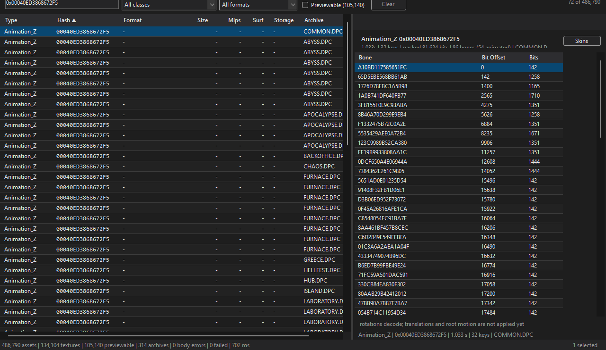

<p align="center">
  <picture>
    <source media="(prefers-color-scheme: dark)" srcset="assets/aptstudio-logo-dark.svg">
    <source media="(prefers-color-scheme: light)" srcset="assets/aptstudio-logo-light.svg">
    
  </picture>
</p>

<p align="center">
  Read-only asset explorer for <strong>A Plague Tale: Resonance</strong>.<br>
  Textures, meshes, materials, skins, skeletons, animation, audio, and the links between them.
</p>

<p align="center">
  <a href="#features">Features</a> ·
  <a href="#build">Build</a> ·
  <a href="#cli">CLI</a> ·
  <a href="#scope">Scope</a> ·
  <a href="#license">License</a>
</p>

<p align="center">
  
</p>

## Features

| Asset | What you get |
| --- | --- |
| Textures | BC1/BC3 mip decoding, channel views, zoom and pan, batch PNG export. |
| Meshes | Software 3D view with orbit, pan, zoom, and hidden-line wireframe. |
| Materials | 58-slot tables, authoring and binding names, slot texture preview. |
| Skins | Mesh links, part table, weight strides, bone palette, pose view. |
| Skeletons | Bone table, bind pose, parent links, and the skins that use them. |
| Animation | Packed rotation decode, frame playback, and a skin picker. |
| Audio | Wwise bank media, Vorbis playback, and Ogg export. |
| Links | Texture → material, mesh → skin, skin → skeleton. |

Counts from the installed Resonance 1.3.0.0 build: 486,790 asset rows across 314 DPCs, 16,227 previewable textures, 235,418 materials, 37,815 mesh bodies, 1,724 skin bodies, 1,678 skeleton objects, 202,727 animation rows, 140,888 audio media.

## Build

Windows and the .NET 10 SDK. No other runtime dependencies.

```bash
dotnet build APTStudio.slnx
dotnet test APTStudio.slnx
dotnet run --project src/AptStudio.Desktop
```

The desktop app opens a game folder, indexes the archives, and keeps its cache under `%LOCALAPPDATA%\APTStudio`. Game files are always opened read-only.

## CLI

```bash
# containers and the whole-game index
aptstudio scan <gameRoot>
aptstudio assets <gameRoot>

# textures
aptstudio list <gameRoot> [--rebuild]
aptstudio export <gameRoot> <nameHash> <outputPath>

# meshes
aptstudio mesh <gameRoot> <nameHash>

# materials and skins
aptstudio materials <gameRoot>
aptstudio material <gameRoot> <nameHash>
aptstudio skins <gameRoot>
aptstudio skin <gameRoot> <nameHash>
aptstudio pose <gameRoot> <skinHash> <boneHash> <degrees> [x|y|z]

# skeletons
aptstudio skeletons <gameRoot> [--rebuild]
aptstudio skeleton <gameRoot> <nameHash>
aptstudio skelbind <gameRoot>

# animation
aptstudio animation <gameRoot> <nameHash>
aptstudio animclip <gameRoot> <nameHash> [frame]

# audio
aptstudio audio <gameRoot>
aptstudio audioconvert <gameRoot> <pack> <mediaId> <output.ogg>

# cross links
aptstudio links <gameRoot>
```

`aptstudio` is the CLI assembly name. From a fresh checkout, `dotnet run --project src/AptStudio.Cli -- <command>` runs the same commands.

## Project layout

| Path | What it is |
| --- | --- |
| `src/AptStudio.Core` | DPC, texture, mesh, material, skin, skeleton, animation, and audio readers plus catalogs and caches. |
| `src/AptStudio.Cli` | The verifier CLI. |
| `src/AptStudio.Desktop` | The WinForms browser, 3D view, and pose window. |
| `tests/` | xUnit coverage for the readers, catalogs, and desktop controls. |

## Scope

Read-only. APTStudio never patches, injects, installs mods, or writes into the game folder. Exports go wherever you point them.

Resonance 1.3.0.0 is the current target. Requiem uses the same DPC family with a measured variant layout and comes after Resonance is complete.

Known limits: animation translations and root motion are measured but not applied; the animation skin picker ranks by shared bone names, so it lists candidates rather than claiming the exact rig; the mesh-to-material rule and the 1,081 root-0 skin bindings are still open.

## License

MIT, see [LICENSE](LICENSE).

Format facts cross-checked against bff (widberg, MIT). Texture decode by BCnEncoder.Net. Wwise Vorbis conversion by Ww2Ogg.Core, playback by NVorbis. Notices in [THIRD-PARTY-NOTICES.md](THIRD-PARTY-NOTICES.md).
